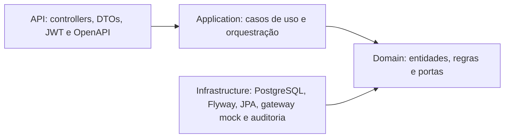

# Arquitetura do backend

[Voltar ao índice da documentação](../README.md)

## Camadas

| Camada | Responsabilidade |
|---|---|
| Domain | Entidades e regras de Usuário, Unidade, ProdutoUnidade, Pedido, Estoque, Pagamento e Auditoria. Não depende de HTTP, banco ou gateway. |
| Application | Casos de uso de cadastro, autenticação, pedido, estoque, pagamento, status e cancelamento. Orquestra transações e autorização de negócio. |
| Infrastructure | Implementa persistência PostgreSQL com migrations Flyway, repositórios, gateway de pagamento mock e auditoria persistida. |
| API | Expõe rotas, valida DTOs, verifica JWT e permissões, devolve respostas e documenta a API em OpenAPI. |

Controllers dependem dos casos de uso. Casos de uso dependem das entidades e das portas de persistência e integração. A infraestrutura implementa essas portas; ela não define regras de pedido, estoque ou pagamento.

## Limites do MVP

O backend implementará pedidos APP, WEB e BALCAO, estoque por unidade, pagamento mock, status, cancelamento e auditoria. TOTEM, PICKUP, fidelidade, campanhas, Owner, múltiplos perfis, gestão completa de unidades e produtos permanecem conceituais.

Requisitos relacionados: RF01–RF08 e RNF01–RNF04, RNF07–RNF08.

[Voltar ao topo](#arquitetura-do-backend)
