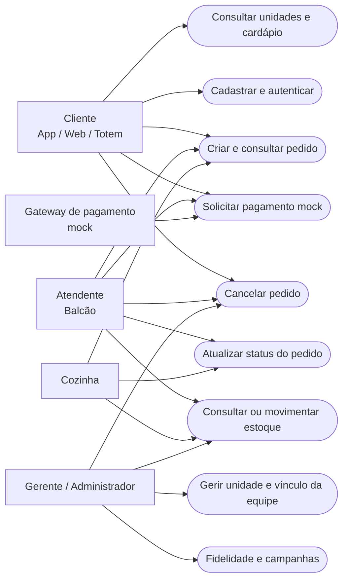

# Casos de uso e feature crítica

[Voltar à modelagem](modelagem.md)

## Casos de uso

Cliente, Atendente, Cozinha, Gerente/Administrador e Gateway estão representados conforme o roteiro. As ações de fidelidade, campanhas e TOTEM têm cobertura conceitual. APP, WEB e BALCAO compõem o MVP.

## Feature crítica — Pedido, pagamento mock e status

**Pré-condições:** unidade existente; produtos associados e disponíveis; saldo suficiente; canal informado; solicitante autorizado quando a operação exigir autenticação.

**Fluxo principal:**

1. Cliente em APP/WEB ou Atendente em BALCAO informa unidade, canal e itens.
2. A API valida estoque e valores, cria o pedido em `AGUARDANDO_PAGAMENTO` e registra a baixa sem efeito parcial.
3. Cliente proprietário ou Atendente autorizado solicita pagamento ao gateway mock.
4. O retorno aprovado é registrado e o pedido passa a `RECEBIDO`.
5. Cozinha inicia o preparo, marca como `PRONTO` e o Atendente conclui o pedido pago.

**Pós-condições:** pedido, itens, movimentações de estoque, tentativa de pagamento e eventos de auditoria ficam persistidos.

**Exceções:** estoque insuficiente impede a criação; recusa ou falha mantém o pedido e permite nova tentativa; retorno repetido não duplica efeitos; BALCAO pode entrar em preparo antes de pagamento; cancelamento permitido devolve estoque uma vez e registra estorno simulado quando o pedido estiver pago.

Requisitos relacionados: RF05–RF08 e RNF04, RNF07.

[Voltar ao topo](#casos-de-uso-e-feature-crítica)
