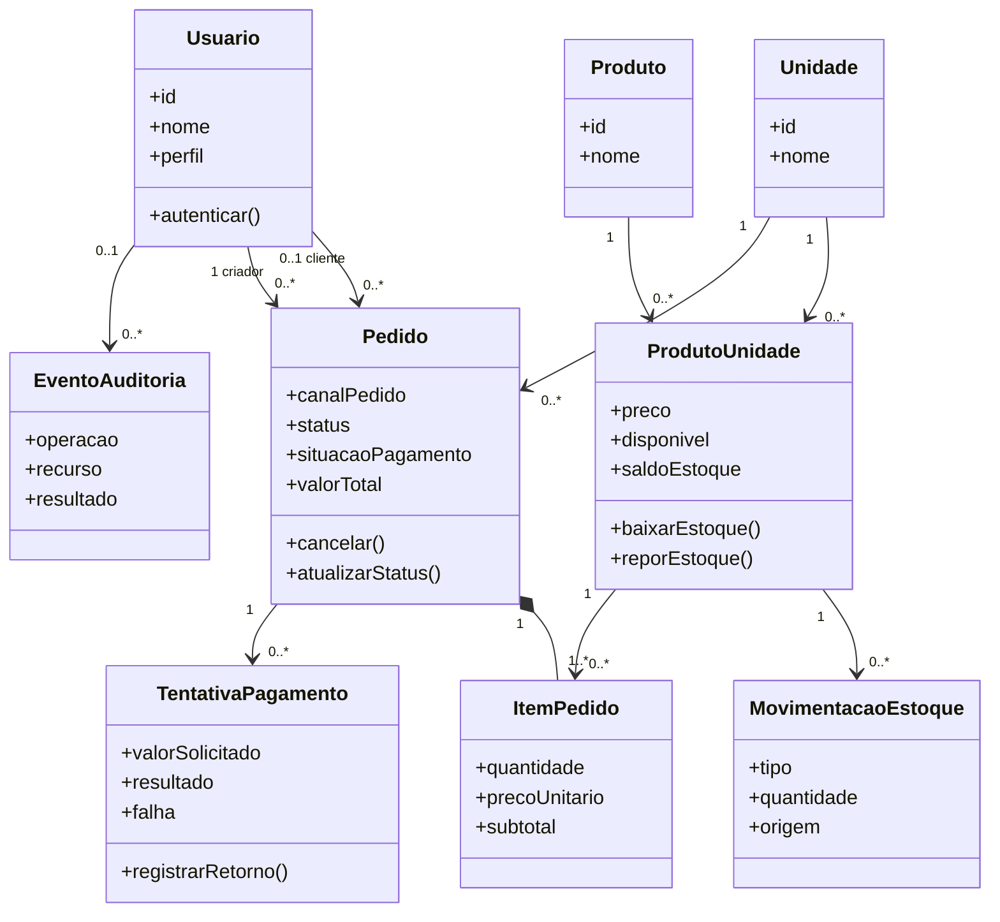

# Diagrama de classes

[Voltar à modelagem](modelagem.md)

O diagrama mostra a visão de domínio. Perfil, canal, status e resultado de pagamento são valores controlados; persistência e detalhes de integração permanecem fora das classes de domínio.

[Voltar ao topo](#diagrama-de-classes)
