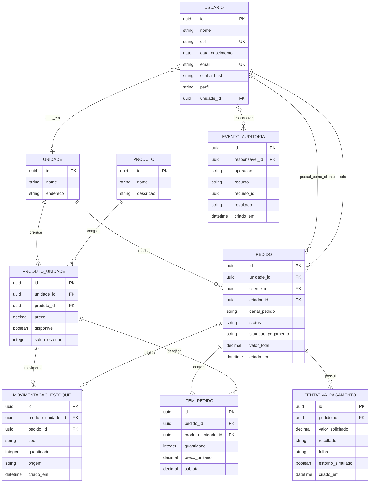

# DER do MVP

[Voltar à modelagem](modelagem.md)

O [DER em imagem](der-raizes-nordeste.png) apresenta as entidades e relações do banco.

## Restrições principais

| Elemento | Restrição |
|---|---|
| Usuário | CPF e e-mail são únicos. Perfil: Cliente, Atendente, Cozinha ou Administrador. Atendente e Cozinha exigem unidade; Cliente e Administrador não possuem unidade de atuação. |
| ProdutoUnidade | O par unidade/produto é único. Preço e saldo não são negativos. Produto indisponível ou sem saldo não aparece no cardápio disponível. |
| Pedido | `canal_pedido` é obrigatório e admite APP, TOTEM, BALCAO, PICKUP e WEB. APP/WEB exigem Cliente; BALCAO não recebe Cliente. TOTEM e PICKUP são conceituais no MVP. |
| ItemPedido | Pedido possui um ou mais itens; quantidade é inteira positiva. ProdutoUnidade do item deve pertencer à unidade do pedido. Valores são calculados pelo sistema. |
| Estoque | Movimentação tem quantidade positiva, entrada ou saída e referência a pedido quando automática. Operações automáticas não se repetem; saldo não fica negativo. |
| Pagamento | Tentativas registram aprovação, recusa ou falha. Retorno repetido não cria novo pagamento ou mudança de status. Estorno é simulado e depende de cancelamento permitido. |
| Status | AGUARDANDO_PAGAMENTO, RECEBIDO, EM_PREPARO, PRONTO, CONCLUIDO e CANCELADO. As transições obedecem RF06 e RF08. |
| Auditoria | Responsável pode ser nulo em evento sem identificação. Não armazena senha, hash, token completo ou dado pessoal completo. |

O diagrama representa as relações do esquema criado pelas migrations Flyway. A exigência de pelo menos um item e a correspondência entre a unidade do pedido e a do produto são validadas pela aplicação; não são restrições independentes do PostgreSQL. CPF e data de nascimento são obrigatórios no cadastro pela API, embora as colunas aceitem nulos no esquema.

Requisitos relacionados: RF01–RF08 e RNF01–RNF04, RNF07.

[Voltar ao topo](#der-do-mvp)
