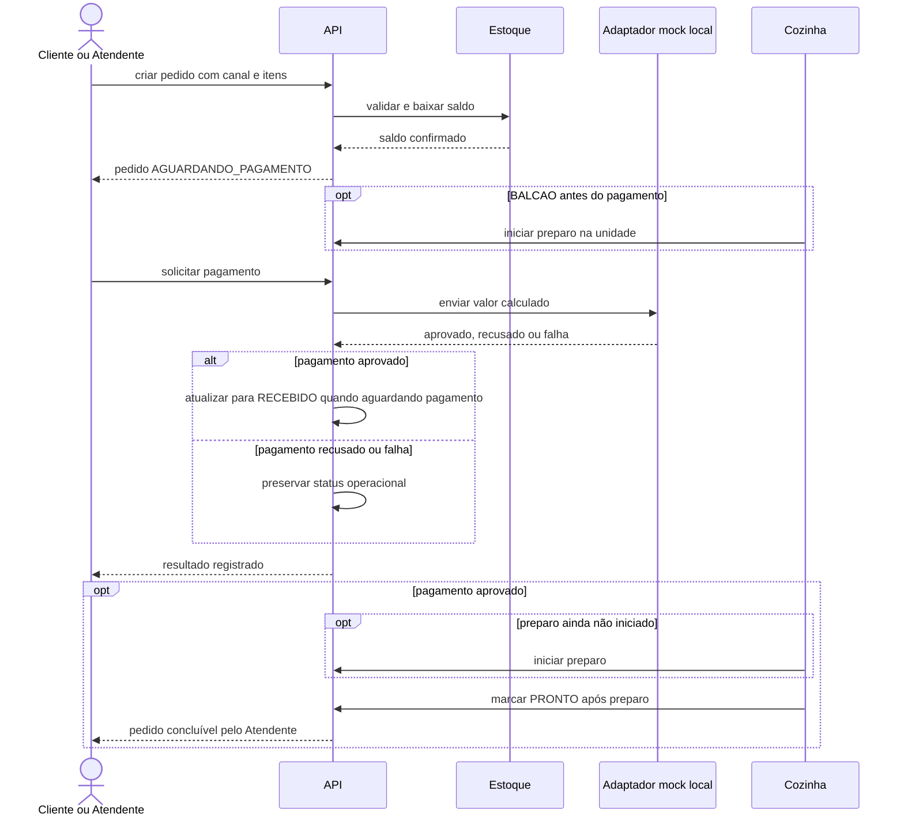

# Sequência do fluxo crítico

[Voltar à modelagem](modelagem.md)

No BALCAO, o preparo pode ocorrer antes da solicitação de pagamento; se já iniciado, a aprovação não retrocede o status. O adaptador é executado na própria API, sem chamada HTTP externa. Recusa ou falha não aprovam o pedido, e repetir uma solicitação já aprovada não duplica efeitos. Cancelamento permitido devolve estoque uma única vez e registra estorno simulado quando aplicável.

[Voltar ao topo](#sequência-do-fluxo-crítico)
