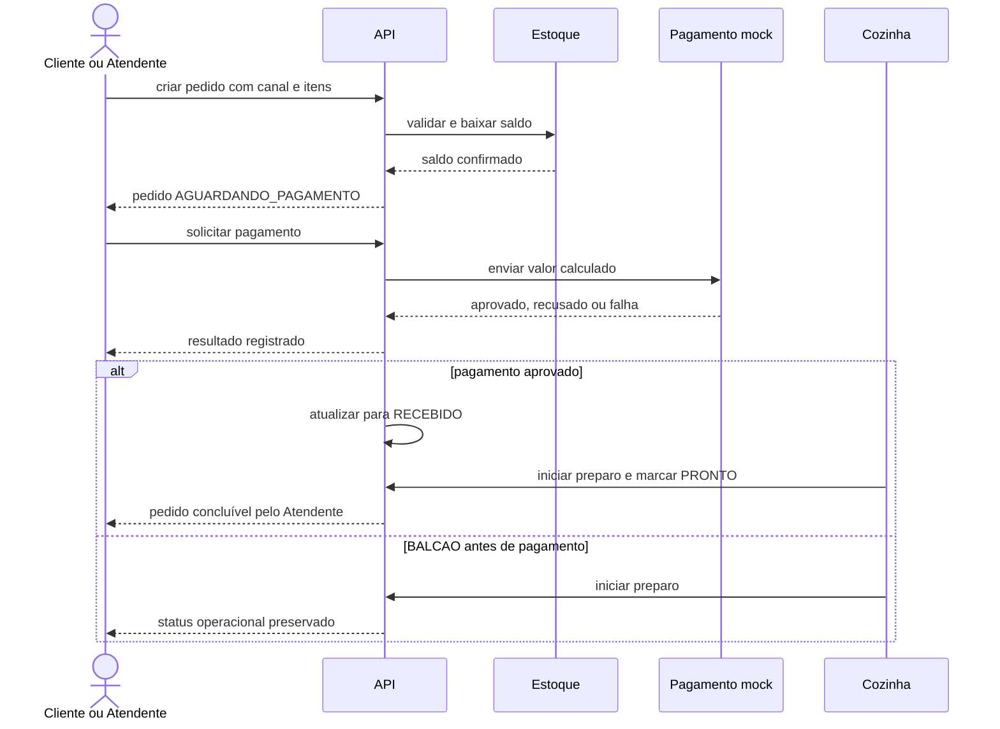

# Sequência do fluxo crítico

[Voltar à modelagem](modelagem.md)

Recusa, falha ou retorno repetido não duplicam efeitos. Cancelamento permitido devolve estoque uma única vez e registra estorno simulado quando aplicável.

[Voltar ao topo](#sequência-do-fluxo-crítico)
